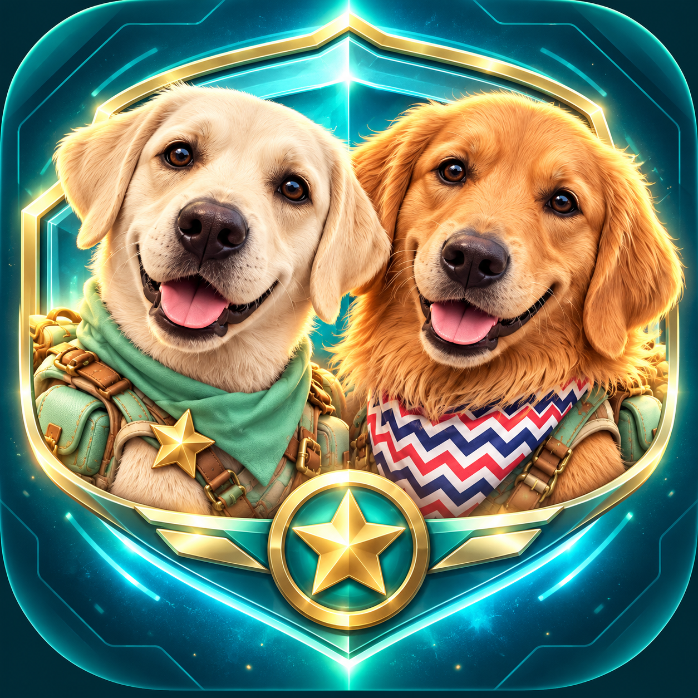

<p align="center"></p>
<h1 align="center">狗狗突击队 · DOG SQUAD</h1>
<p align="center"><strong>每一声呼叫，都值得一个回答。</strong><br>Ramen 与 Bing Bong 的六章科幻救援冒险。</p>
<p align="center"><a href="https://qx04222.github.io/dog-squad/">游戏官网</a> · <a href="https://qx04222.github.io/dog-squad/play/">直接游玩</a> · <a href="https://github.com/qx04222/dog-squad/releases/tag/v1.1.0">下载 1.1</a> · <a href="docs/STORY.md">故事设定</a></p>


> 上图为项目原创宣传插画。实际游戏为 Canvas 绘制的纵向战术射击，官网提供完整实机试玩。

城市的导航系统宣布“一切安全”，然后锁死了全部出口。沉着的拉布拉多 Ramen 与爱折腾零件的金毛 Bing Bong，从一通没有被接听的求救开始，穿越封锁街道、海岸、天空花园与机械极光，追寻一艘迟到四年的方舟。

没有账号、体力条或内购。48 个行动、六章故事，下载后可离线玩。

## 开始冒险

| 版本 | 入口 | 要求 |
| --- | --- | --- |
| 浏览器 | [在线游玩](https://qx04222.github.io/dog-squad/play/) | 现代浏览器，键盘或触控/鼠标 |
| Mac | [下载 DMG](https://github.com/qx04222/dog-squad/releases/download/v1.1.0/Dog-Squad-1.1.0-arm64.dmg) | Apple Silicon，macOS 13 或更新 |
| 离线网页 | [下载 Web ZIP](https://github.com/qx04222/dog-squad/releases/download/v1.1.0/Dog-Squad-1.1.0-Web.zip) | 解压后打开 HTML，无需服务器 |

Mac：打开 DMG，把 **Dog Squad** 拖进“应用程序”，再从应用程序启动。本版本使用 ad-hoc 签名，尚无 Apple Developer ID 公证；macOS 可能要求在“系统设置 → 隐私与安全性”中确认打开。不会要求关闭系统安全设置。Intel Mac 原生包尚未提供，可使用网页版。

## 在战场上做决定

- **两位队长，两个打法。** Ramen 控场与救援，Bing Bong 穿甲与火力；每位队长有三条训练路线，自由调整已获得的训练点。
- **四种主动能力。** 电磁脉冲、队长战术、搭档支援和终极技能相互配合，八套装备改变你的取舍。
- **越危险，越有机会。** 冲刺穿过敌弹触发完美闪避，补充护盾与终极能量；180ms 技能输入缓冲让关键操作更顺手。
- **会变化的战场。** 护盾、修复、快攻、交叉火力与多阶段 Boss；七种战场芯片、连击过载和三项战术评级。
- **一场完整远征。** 六座插画岛屿、48 个地图节点。开场用一张明信片讲故事，结算用真实星级留下战绩；完整故事随时按需展开。
- **保留你的旅程。** 自动本地存档、导出/导入与原生双份备份；标准与辅助模式分别记录成绩。


| 操作 | 按键 |
| --- | --- |
| 移动 | A / D、← / →，或鼠标 / 触控拖动 |
| 电磁脉冲 | Space |
| 队长战术 | Q |
| 搭档支援 | E |
| 终极技能 | R |
| 冲刺 | Shift + 方向，或屏幕冲刺按钮 |
| 暂停 | Escape |

## 本地开发

Node.js 22+（CI 使用 24）。没有前端框架、在线字体或运行时 CDN；网页版由同一份源文件构建为独立 HTML。

```sh
git clone https://github.com/qx04222/dog-squad.git
cd dog-squad
npm ci
npm run check
npm test
npm run build
```

打开 `index.html` 即可游玩。其他命令：

```sh
npm start          # Electron 开发运行
npm run build:site # 静态官网 + 在线游戏 → dist/site
npm run pack:web   # 独立网页 ZIP
npm run pack:mac   # 在 Apple Silicon Mac 上生成 DMG + ZIP
```

网页版构建不需要 Electron 二进制；CI 使用 `ELECTRON_SKIP_BINARY_DOWNLOAD=1 npm ci`。

## 更新与版本

**当前版本为 1.1.0**，采用新的可爱插画界面。1.0.0 是首个公开版本，开发时期的 6.0 不代表更新的公开发行版。存档格式、关卡 ID 与原生应用标识保持不变；显示版本和关卡兼容能力独立维护。

Mac 更新器检查签名清单、下载并验证安装包，准备好后由玩家选择重启安装；战斗中不能安装。独立章节包使用另一组签名验证。私钥不在源码或应用里。旧的 6.0 本地安装包需要手动安装一次 1.1，之后使用新的更新通道。签名与发布步骤见 [发行指南](docs/RELEASING.md)。

浏览器存档属于当前浏览器来源，Mac 存档属于本机用户目录；二者之间可在游戏设置中导出/导入 JSON。卸载章节不会删除已获得的成绩。

## 项目结构

```text
src/       游戏引擎、渲染、音频、UI、存档与成长
content/   内置战役及可签名的扩展章节数据
desktop/   隔离的 Electron 外壳、更新与本地保存
assets/    人物、敌人、Boss、世界图和来源说明
site/      公开官网与签名发布元数据
scripts/   构建、打包与发行工具
tests/     游戏规则、内容、安全、存档回归
```

欢迎提交具体问题和小范围改进，见 [贡献指南](CONTRIBUTING.md)。涉及更新器、包解析或文件访问的安全问题请先阅读 [安全说明](SECURITY.md)。设计与验收路线见 [1.1 视觉升级](docs/V1.1-VISUAL-PLAN.md)。

代码使用 [MIT](LICENSE)；美术与故事内容按 [CC BY 4.0](LICENSE-ASSETS.md) 提供，来源说明见 [素材记录](assets/PROVENANCE.md)。美术包含 AI 辅助生成，音乐和音效由项目代码合成。第三方依赖仍遵循其各自许可证，见 [第三方说明](THIRD_PARTY_NOTICES.md)。
